> 本文整理自《樂理初階2023》([kidstheoryhk.com](https://kidstheoryhk.com/),程度约三级),为学习乐器的初级学生编写的基础乐理工具书。本文内容与原书保持一致,并附原书配图,仅供学习交流;如需进阶,可继续学习《五级乐理自学课程》或《十课常规班际课程》。

## 单元一:怎样阅读乐谱?

乐谱是以文字记录音乐的媒介。无论一首乐曲是多简单或多复杂,乐谱的基本格式大致相同。谱号、拍子记号、拍子时值、休止符、小节线等,是组成一份乐谱的基本元素。懂得阅读及理解乐谱上的描述,能为我们准确演绎一首作品奠下基础。

从深与浅两首作品来看,它们也有共通点,就是基本格式相同:有谱号、拍子记号、调号等。

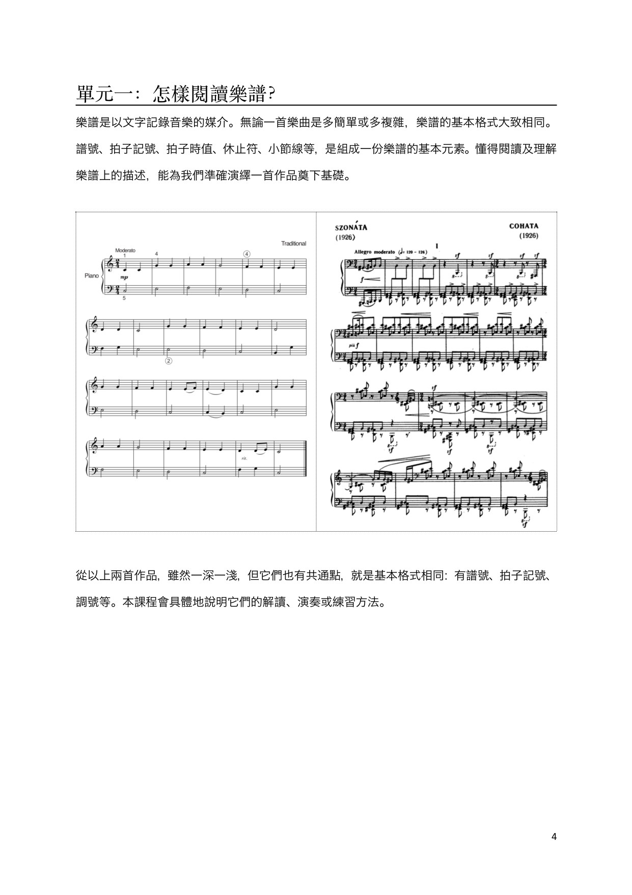

## 单元二:谱号 (Clefs)

我们常用的谱号有高音谱号、中音谱号、次中音谱号和低音谱号,各自有其负责的音域。无论用哪种谱号,它们表示的都是同一个音——**中央 C (middle C)**。

- 高音谱号 (Treble Clef)
- 中音谱号 (Alto Clef)
- 次中音谱号 (Tenor Clef)
- 低音谱号 (Bass Clef)

不同乐器使用的谱号:

| 弦乐器 (String) | 木管乐器 (Woodwind) | 铜管乐器 (Brass) |
| --- | --- | --- |
| 小提琴 violin:高音谱号 | 短笛 piccolo:高音谱号 | 小号 trumpet:高音谱号 |
| 中提琴 viola:中音谱号 | 长笛 flute:高音谱号 | 圆号 horn:高音谱号 |
| 大提琴 cello:低音谱号 | 单簧管 clarinet:高音谱号 | 长号 trombone:低音谱号(也看音域) |
| 低音大提琴 double bass:低音谱号 | 双簧管 oboe、英国管 English horn:高音谱号 | 大号 tuba:低音谱号 |
| | 巴松管 bassoon、低音巴松管 double bassoon:低音谱号 | |

有些乐器由于音域较广阔,如用单一谱号来表达,或需加进很多附加线,为演奏者读谱增加难度。所以,在那些乐器的乐谱,有时会用上两、三种谱号来记谱,如中提琴、大提琴等。

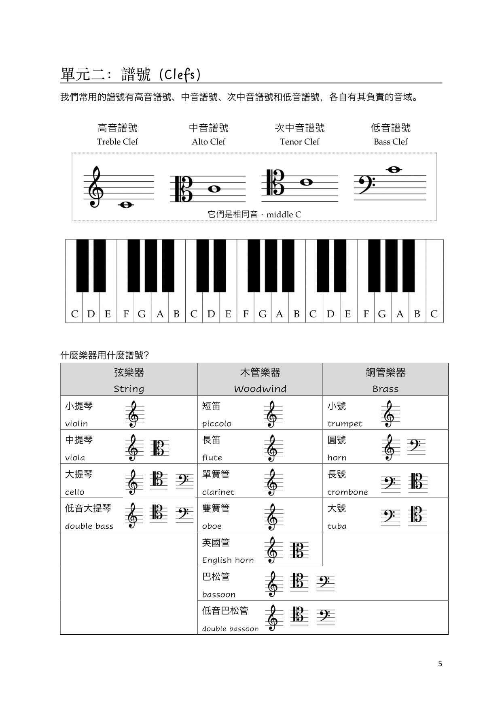

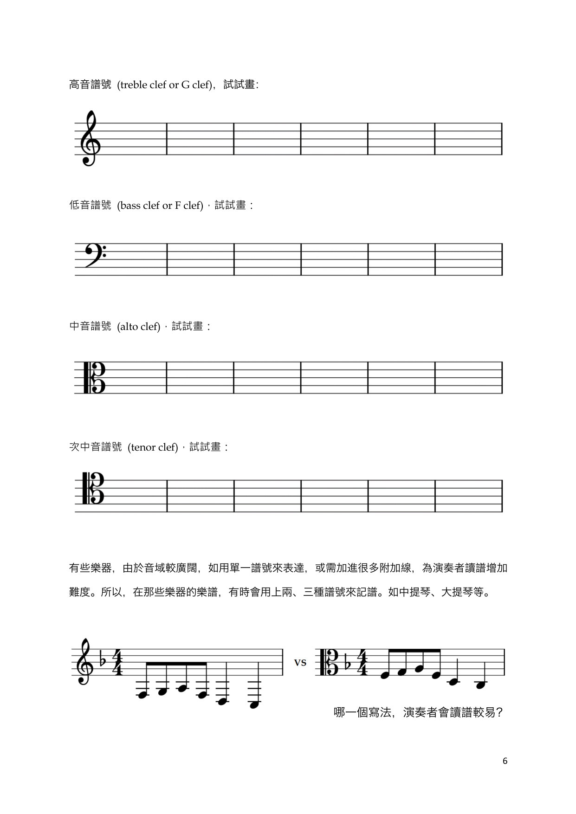

## 单元三:拍子时值 (Time Values)

音乐中,拍子的种类如下(以四分音符为一拍计):

- **倍全音符 / 二全音符** (double whole-note / breve):8 拍
- **全音符** (semibreve):4 拍
- **二分音符** (minim):2 拍
- **四分音符** (crotchet):1 拍
- **八分音符** (quaver):1/2 拍
- **十六分音符** (semiquaver):1/4 拍
- **三十二分音符** (demisemiquaver):1/8 拍
- 更小的还有 1/16(六十四分音符)、1/32 等

除以上的基本拍子外,还有连音、延音线、附点节奏等概念辅助,令拍子时值的系统完善。

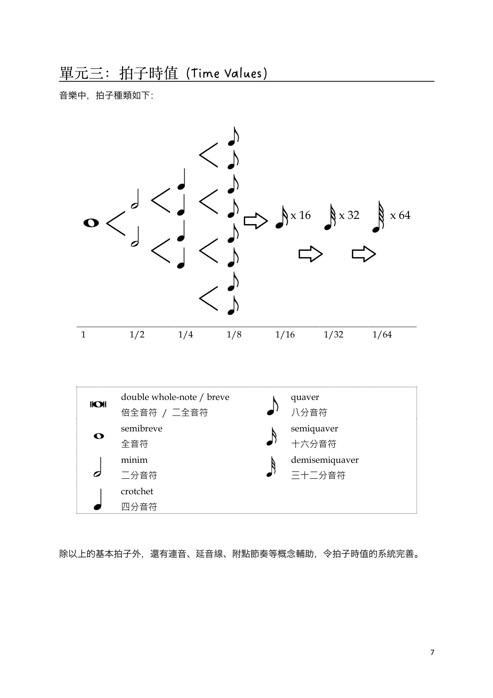

## 单元四:拍子记号 (Time Signatures)

在乐谱开端,放在调号右边的数字或符号,就是拍子记号。它告诉演奏者以什么拍子时值来作数拍子的基本单位,以及小节中强拍和弱拍的分布。例如以二分音符来作拍子的基本单位(一拍),或以八分音符来作拍子的基本单位(一拍)。

- 一个数字在上,一个数字在下:上面的数字表示一个小节内有几拍,下面的数字表示以几分音符做一拍。
- 有时,拍子记号会以符号来表示。例如 `C` 表示 Common Time(4/4 拍),`C` 加一竖线表示 Alla Breve(2/2 拍)。

对于初学乐器的学生,大多以为四分音符就是一拍,这是不尽不实的。有些时候,四分音符也可以是两拍,一切视乎拍子记号而定。举个例子,8 分音符为一拍时,一个小节里有五拍,那么现在八分音符就是一拍了。

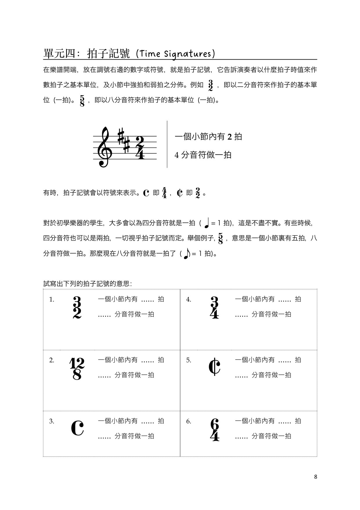

## 单元五:连音、延音线和附点节奏 (Tuplets, Ties and Dotted Rhythm)

### 连音 (tuplet)

以四分音符为一拍时,八分音符为半拍……那么,音乐上有没有 1/3 拍、1/5 拍的呢?有!我们会运用连音去完善这个拍子系统。连音用来表示不规则拍子,如**三连音** (triplet) 表示 1/3 拍、**五连音** (quintuplet) 表示 1/5 拍。

### 延音线 (tie)

延音线有两个用途:(a) 用来表示复杂的拍子;(b) 解决小节内拍子限制之问题——当音符跨过小节线时,用延音线把时值连起来。

### 附点节奏 (dotted rhythm)

附点用来简化拍子的写法。加一个附点,时值增加原来的一半:

- 附点二分音符:三拍
- 附点四分音符:一拍半
- 双附点四分音符:一又四分之三拍

如我们将不同的拍子串连起来横向演奏,就形成节奏。一般学生在学习乐器上面对的困难,就是对节奏的掌握。音乐节奏千变万化,多变的节奏才能令音乐不致单调沉闷。初级乐器之学生,必须背熟各拍子之总时值——全部都是四分音符。

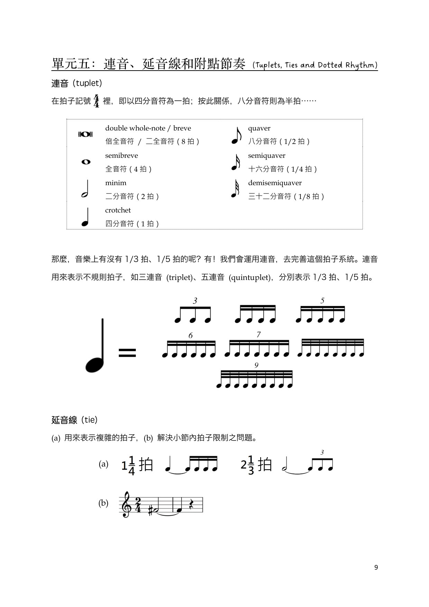

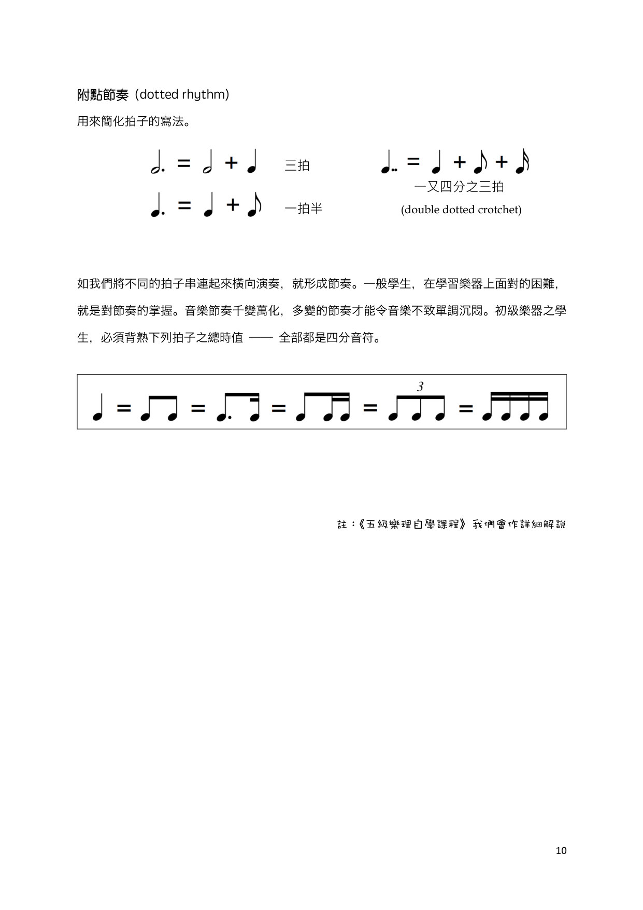

### 节奏练习

《练习一》:开启拍子机 (metronome),速度 = 60,用双手拍拍下列各题节奏。

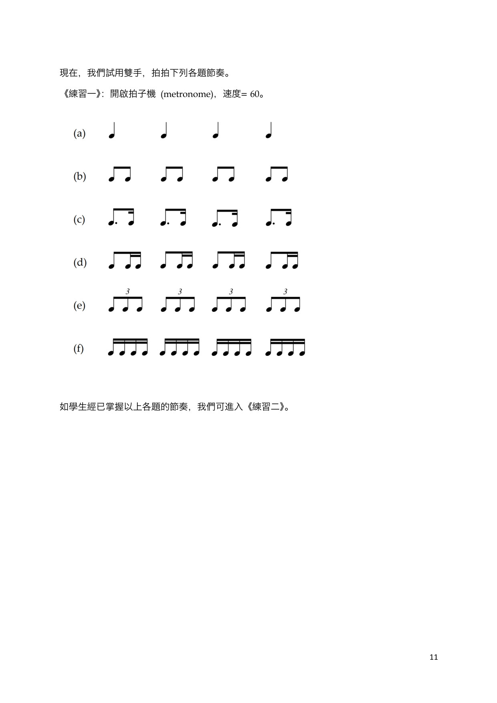

《练习二》:将上述的节奏抽选混合,然后拍出。

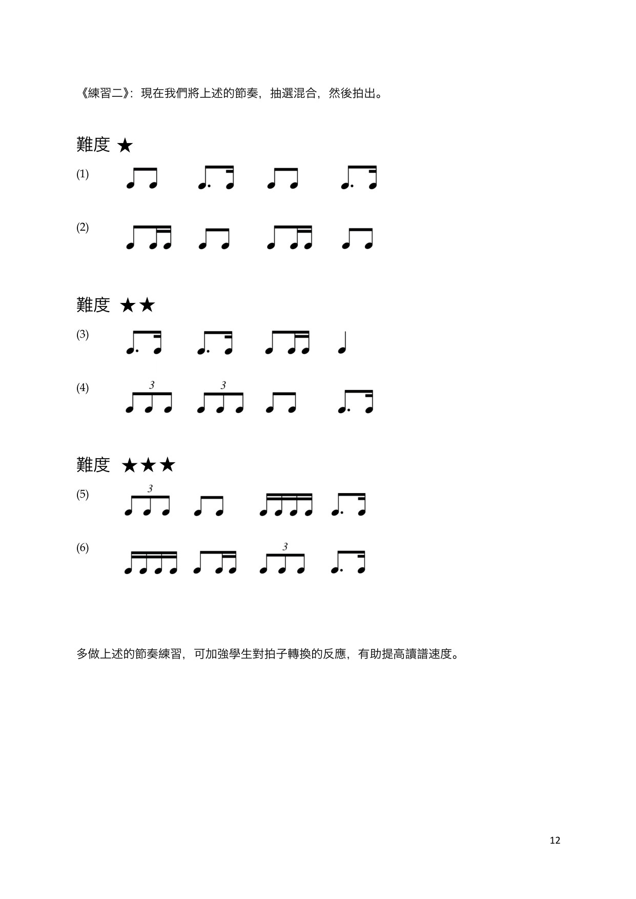

多做上述的节奏练习,可加强学生对拍子转换的反应,有助提高读谱速度。

## 单元六:休止符 (Rests)

不要以为有声音才是音乐,适当的停顿也是音乐上不可缺少的元素。常用的休止符如下:

- 全休止符 (semibreve rest)
- 二分休止符 (minim rest)
- 四分休止符 (crotchet rest)
- 八分休止符 (quaver rest)
- 十六分休止符 (semiquaver rest)
- 三十二分休止符 (demisemiquaver rest)

**如整个小节休息,无论拍子记号如何,我们统一用全休止符 (semibreve rest)。**

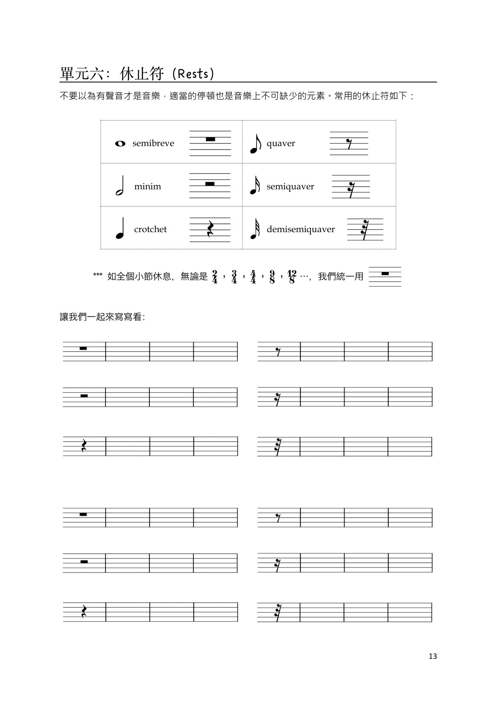

## 单元七:小节及小节线 (Bars & Bar-lines)

大家都有上学的经验。在学校里,有学生、有班房,班房与班房之间有墙分隔。在乐谱里,音符就像学生,小节就像班房,小节线就像一道墙用来分隔小节。小节可以清楚地界定音符的位置,及显示强拍与弱拍的分布。

为什么小节能清楚界定音符的位置?假如我说从第十三个音开始弹起,演奏者需要从左至右慢慢数,找音的时间相对较长。但是,假如我说从第四小节开始弹起,演奏者应会更清楚、更快捷找到正确目标。所以,小节的用途就是清楚地界定音符的位置。

小节线的种类:

- **单小节线**:将乐谱分为各个小节
- **复纵线**:表示一个部分的结束
- **终止线**:一部作品的结尾

在拍子记号的概念中,可分为**单拍子**及**复拍子**。单拍子的定义,是一个单位的拍子可分为两份;复拍子是一个单位的拍子可分为三份。按每个小节内的拍数,又可分二拍子 (duple)、三拍子 (triple)、四拍子 (quadruple)。

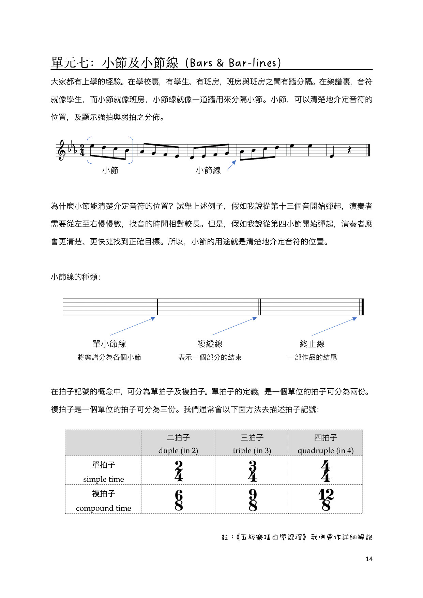

二拍子、三拍子及四拍子,在小节里的节拍有强弱之分:

- 二拍子:强、弱
- 三拍子:强、弱、弱
- 四拍子:强、弱、次强、弱

每首乐曲未必需要一定从第一小节的第一拍开始奏起,有时也可以从第三拍、第四拍的位置开始,我们称为**弱起拍** (anacrusis)。我们熟悉的《生日歌》就是典型例子。

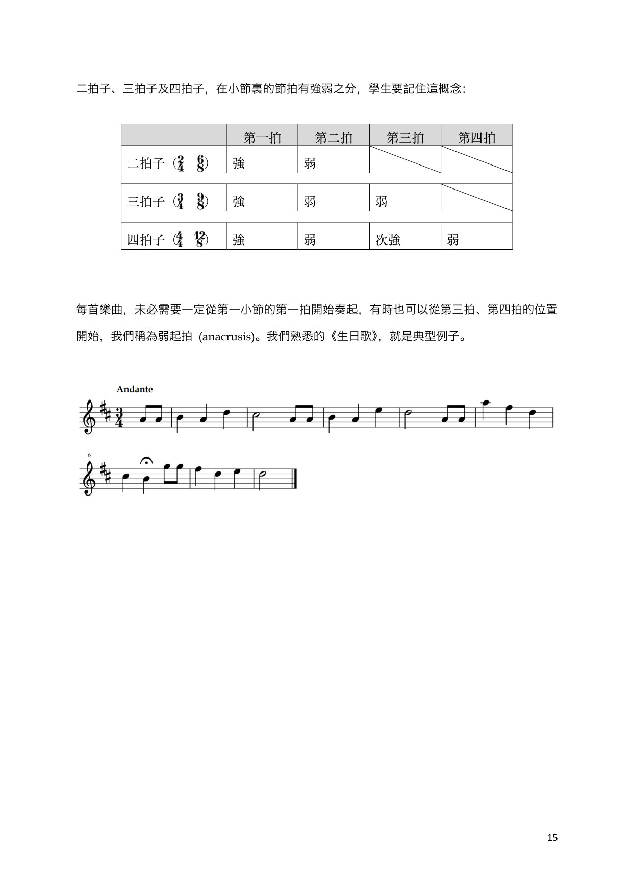

## 单元八:音量及速度 (Dynamics & Tempo)

音乐是声音,有强和弱的表现。在乐谱上,音量以下列方式表达(从最弱到最强):

`ppp`(最弱)、`pp`、`p`、`mp`、`mf`、`f`、`ff`、`fff`(最强)

- **cresc.** (crescendo):渐强
- **dim.** (diminuendo):渐弱

一首作品速度的快慢,决定於乐谱开端左上角的速度指示,与乐谱里的拍子时值无关。**两个看似不同的速度标记,只要每一拍对应的音符时值换算后相同,速度就一样**——这是初学阶段最容易混淆的点。

常用速度术语:

| 术语 | 中文 | 速度 |
| --- | --- | --- |
| Largo | 慢板 | 40–60 bpm |
| Larghetto | 稍缓板 | 60–66 bpm |
| Adagio | 柔板 | 66–76 bpm |
| Andante | 行板 | 76–108 bpm |
| Moderato | 中板 | 108–120 bpm |
| Allegro | 快板 | 120–168 bpm |
| Presto | 急板 | 168–200 bpm |

另有 ritardando (rit.) 渐慢、rallentando (rall.) 渐慢、accelerando (accel.) 渐快、a tempo 原速。

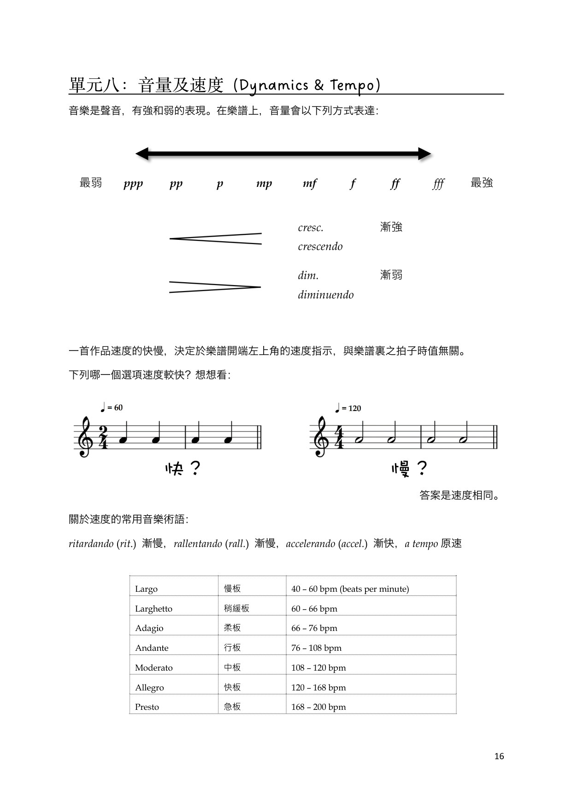

**拍子机**(metronome)是量化音乐速度的工具。拍子机上的数字,表示一分钟内拍子机拍打的次数。如调到 60,即一分钟拍打 60 次;调到 120,即一分钟拍打 120 次。数字越大,速度越快,但是我们最终还要看清楚拍子单位来决定速度——例如四分音符=120 与八分音符=60,实际速度相同。

使用拍子机的好处,除可令学生数拍子数得更准确外,还可以:

1. 替学生找出不熟练的地方——如乐句不熟,根本不会跟到拍子机的节拍;
2. 加强演奏自信——拍子机的节拍,会令演奏者更在意拍子的准确性,从而带来紧张感,若自信不足就很容易出错。

要练习更有效率,建议使用拍子机,以慢速练习。

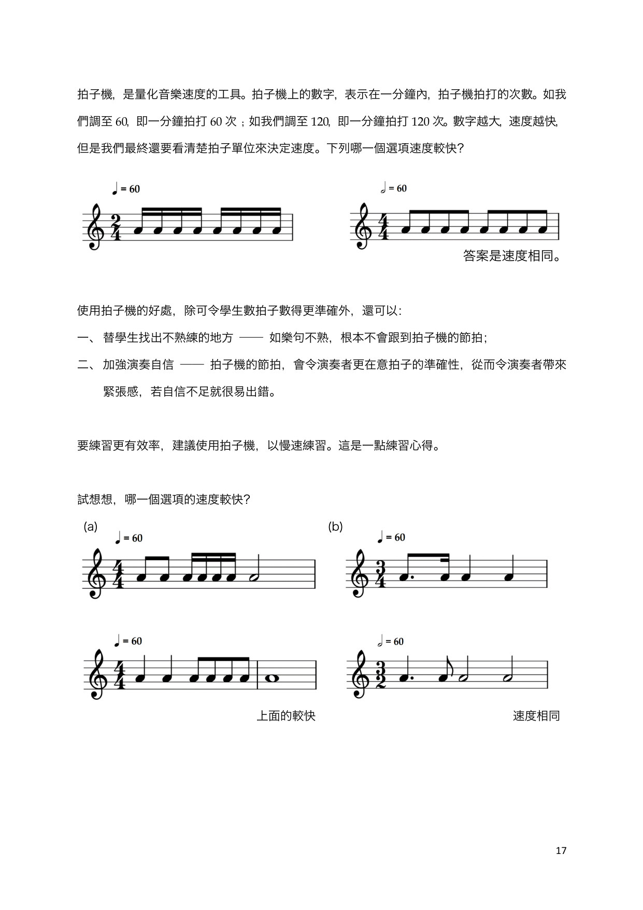

## 单元九:演奏指示 (Performance Directions)

作曲家创作一首作品,当然有他心目中的完美声音效果。但是,当作品交到一位演奏者面前,作品是否能如作曲家所愿,充分表现他理想中的声音,这就需要作曲家在乐谱上清楚交待演奏的细节。而在乐谱上以文字或图像表达的详细说明,就是**演奏指示**。

古典音乐中所用的演奏指示,文字均以意大利文、德文及法文为主,这与西方音乐兴起自欧洲等地有关。我们熟悉的作曲家巴哈、贝多芬、莫札特均来自德国,他们以熟悉的母语来写作品,理所当然。

根据 ABRSM 的乐理知识指标,初级乐器学生所需要懂得的音乐符号和术语如下:

1. crescendo 渐强 (gradually getting louder)
2. diminuendo 渐弱 (gradually getting softer)
3. slur 圆滑线
4. tie 延音线
5. staccato 断奏
6. accented 重音
7. fermata, pause 延长号
8. 数字速度(如 = 120)一分子里有 120 个四分音符的拍子
9. repeat mark 重复
10. common time:每个小节里有四拍,四分音符为一拍
11. strong accent 强重音
12. semi-staccato: slightly separate 次断音
13. staccatissimo: very short accented 短断音
14. tenuto, slight pressure 保持,稍为强调
15. 比记谱高八度演奏 (perform an octave higher)
16. alla breve: 2 minim beats in a bar(2/2 拍)
17. rest for two bars 两小节休息
18. first time bar 第一次
19. second time bar 第二次
20. arpeggiation 琶音:把和弦的音从低到高快速依次弹出

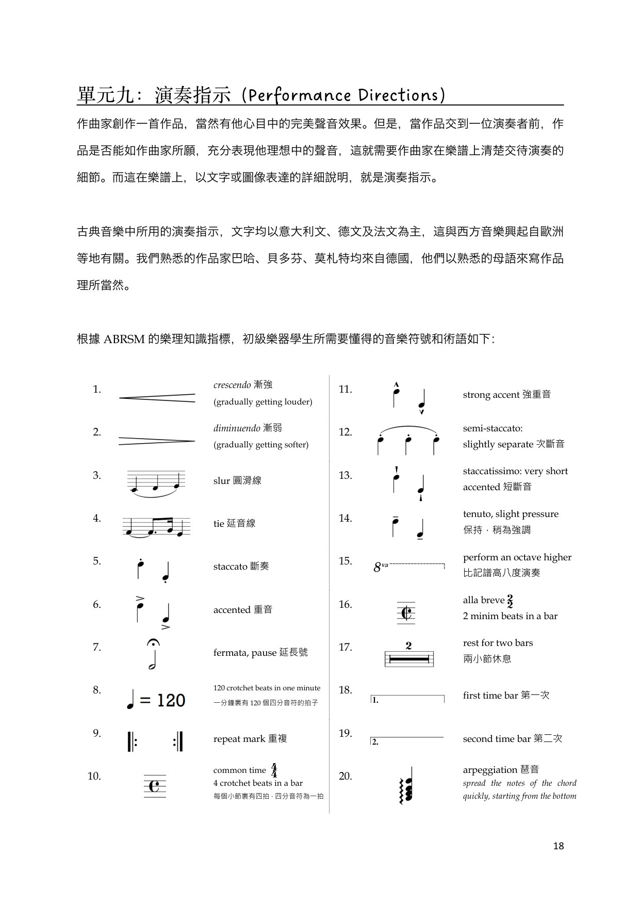

### 音乐词汇 (Terms)

**Grade 1** 常用意大利术语:

a tempo 回复原速、accelerando (accel.) 渐快、adagio 慢板、allegretto 稍快板、allegro 快板、andante 行板、cantabile 如歌唱一般的风格、crescendo (cresc.) 渐强、da capo (D.C.) 从头再奏、decrescendo (decresc.) 渐弱、diminuendo (dim.) 渐弱、dolce 甜美的柔和的、f (forte) 强、ff (fortissimo) 十分强、fine/al fine 完结直至结尾、legato 圆滑流畅、mf (mezzo forte) 中强、moderato 中板、mp (mezzo piano) 中弱、p (piano) 弱、pp (pianissimo) 十分弱、rallentando (rall.) 渐慢、ritardando (ritard./rit.) 渐慢、staccato (stacc.) 断奏。

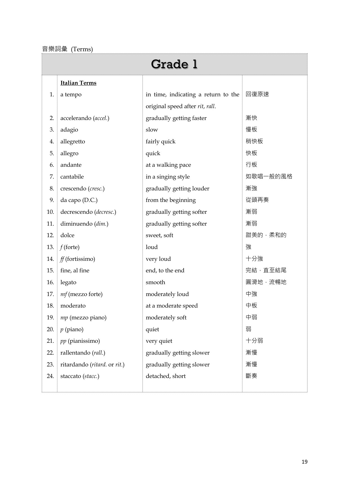

**Grade 2** 常用意大利术语:

alla marcia 进行曲风格、allargando 渐慢及渐强逐渐宽广、con moto 活跃地流动地、con/col 用带有、dal segno (D.S.) 从记号处奏起、e/ed 和与及、espressivo (espress.) 有表情的、fp (fortepiano) 开始强随即弱、grave 严肃的极缓慢的、grazioso 优美的优雅的、largo 广板、lento 慢板、ma 但是、meno 少些、meno mosso 速度稍慢、molto 十分很、non troppo 不太…的、più 更多的较多的、più mosso 稍快、poco/poco a poco 少许逐渐地、presto 急板、ritenuto (riten.) 突慢立即放慢、senza 没有不去除、vivace/vivo 生动的活泼的。

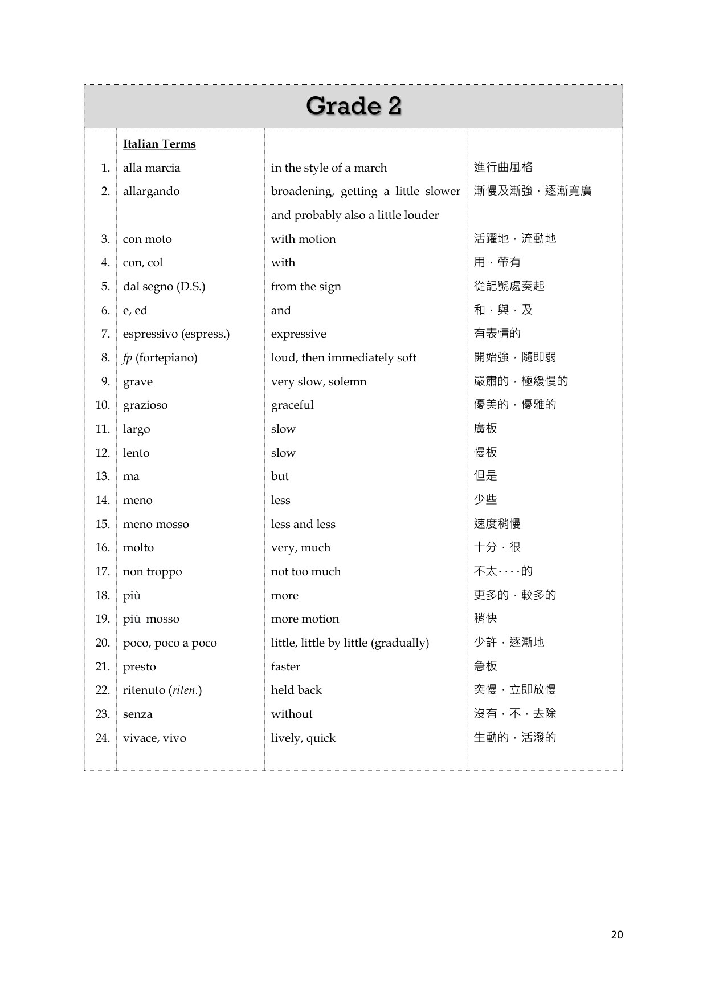

**Grade 3** 常用意大利术语:

agitato 激动的兴奋地、andantino 小行板比行板稍快、animato 活泼的有生气的、ben 好很非常、con forza 有力量地、energico 充满精力地、giocoso 喜悦的愉快的、leggiero 轻快地轻巧地、maestoso 庄严地堂皇地、marcato (marc.) 强调的加重音的、pesante 沉重的、prestissimo 极快最急板、prima/primo 第一的主要的、risoluto 坚强的有力的、scherzando 滑稽的开玩笑的、semplice 单纯的纯朴的、sempre 始终常常一直、sforzando/sforzato (sfz, sf) 加强的突强的、simile (sim.) 同样地相似地、sostenuto (sost.) 持续的保持的、subito (sub.) 突然立刻、tranquillo 平静的宁静的、triste/tristamente 伤心的悲伤的。

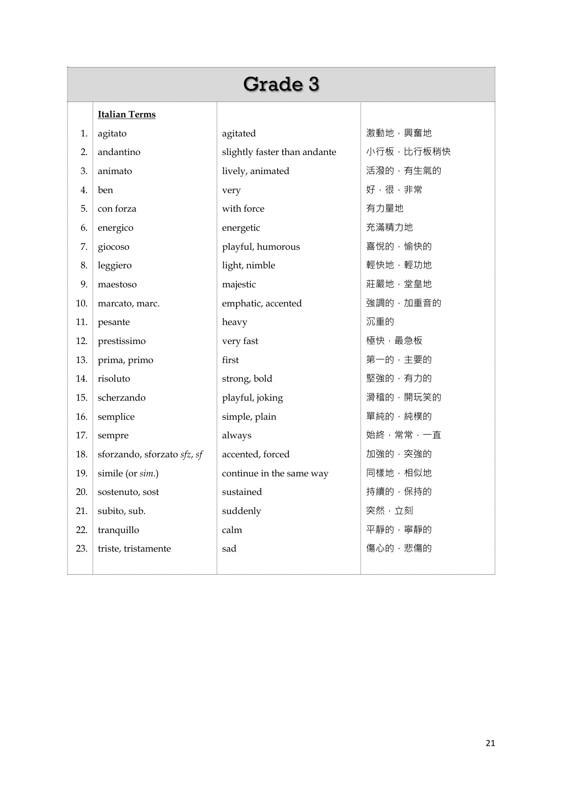

### 装饰音 (Ornaments)

装饰音可分五种:

- **(a) acciaccatura / grace notes 短倚音(碎音)/ 花音**:当一个很短的音出现时称 acciaccatura;当两个或以上很短的音出现时称 grace notes。
- **(b) appoggiatura 长倚音**
- **(c) turn 顺回音**
- **(d) trill 震音**
- **(e) upper mordent 上波音 / lower mordent 下波音**

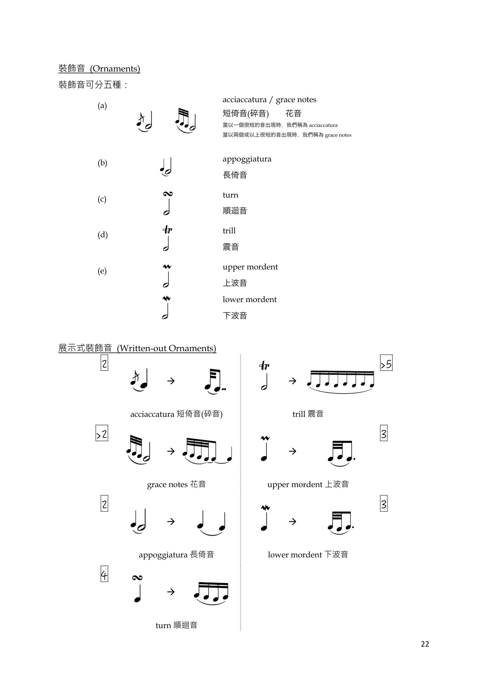

装饰音的用途,是美化旋律,令音乐表现更丰富。再以孩子们熟悉的《生日歌》为例:未加入装饰音前、加入装饰音后、弹奏效果——加入装饰音后旋律丰富了很多。

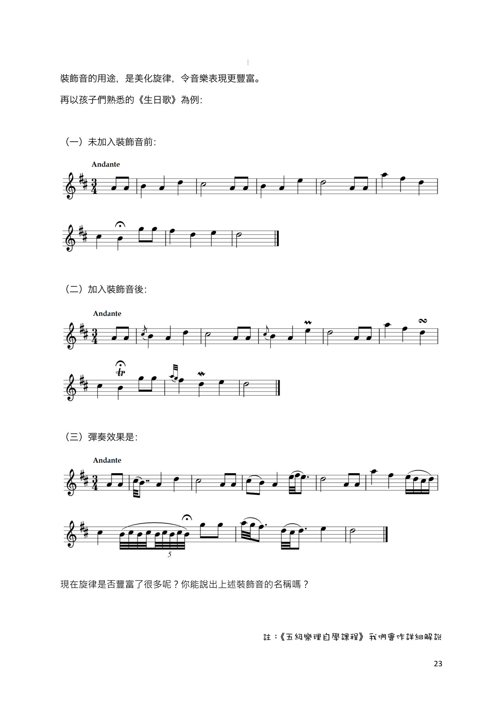

## 单元十:音名 (Letter Names)

在古典音乐系统中,一个八度可划分为十二个不同的音高 (pitch),而每个音都有它的名字,这就是**音名**。音名由基本七个英文字母命名 (C D E F G A B)。但是,单用七个英文字母,并不足以表达十二个不同的音高,加进**变音记号** (accidentals) 就能解决这问题。初级乐器的学生常遇到的变音记号,包括:

- **升高半音** (sharp,♯)
- **降低半音** (flat,♭)
- **还原** (natural,♮)

在五线谱表达上,变音记号加在音符的左边;在文字或口述的表达上,变音记号加在音名的后面。

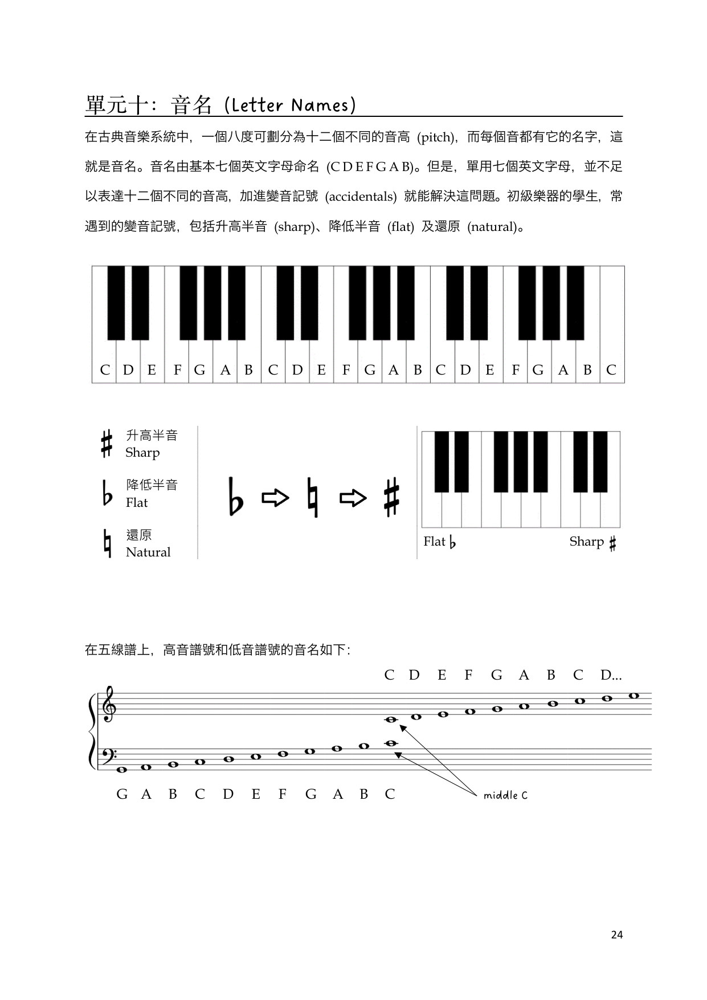

为方便记忆,数得更快更准,可记住这两组英文字母。高音谱号各线间、低音谱号各线间的音名有固定规律,记住它们就能快速数出任意位置。

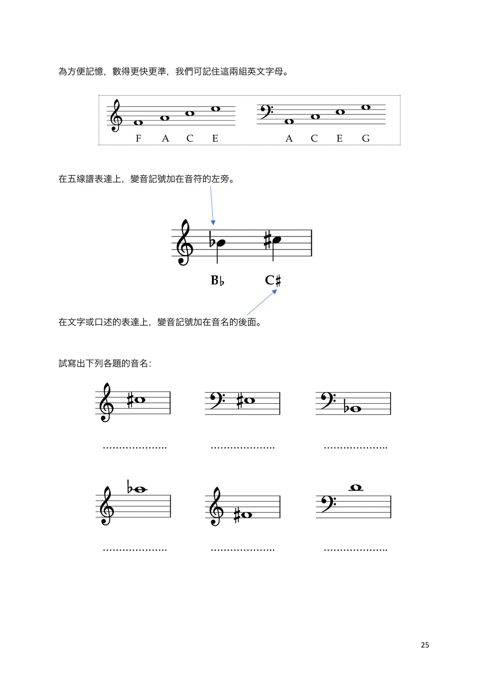

## 单元十一:半音与全音 (Semitone & Whole tone)

在一个八度里,可划分十二个不同的音高。如从某音开始,上行或下行一步,我们称那两个音的关系为**半音**;如从某音开始,上行或下行两步,我们称那两个音的关系为**全音**。

练习:判断下列各组音是半音还是全音关系。

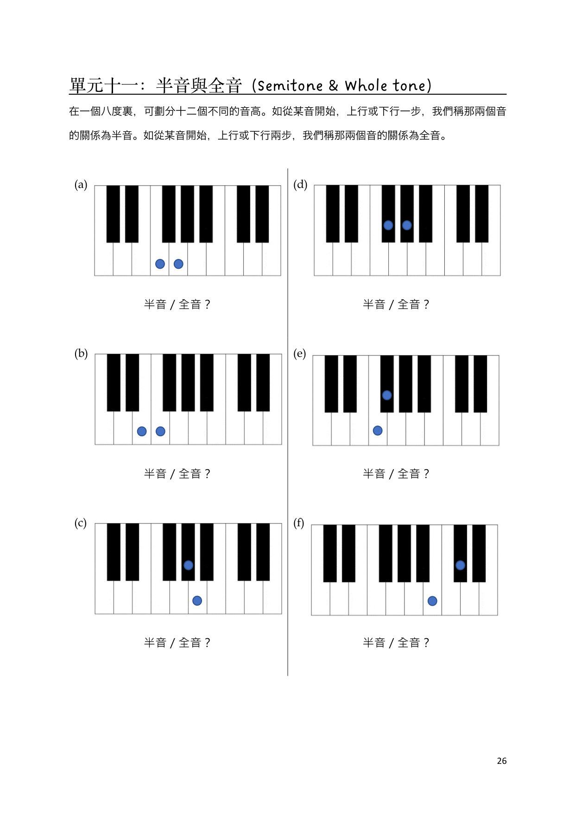

## 单元十二:大调与小调 (Major & Minor Tonalities)

大调和小调,从听觉官感上有何不同?概括地说,大调带有阳光、祥和及正面的感觉,小调却带有忧伤、负面或民族色彩的感觉。

古典音乐的调性音乐作品中,通常会以某音为中心,而那个音亦是作品中最重要的音,称为**主音** (tonic)。主音具有稳定的地位,它像一块磁石,其他音会倾向、有计划地逐渐走向以那个主音为根的和弦,然后令乐句结束。我们常常听到作品是 G 大调、D 大调,究竟是什么意思?举个例子,如果作品是 G 大调,即以 G 为中心,即使音乐怎样变化发展,最后都会以 G 为终结。

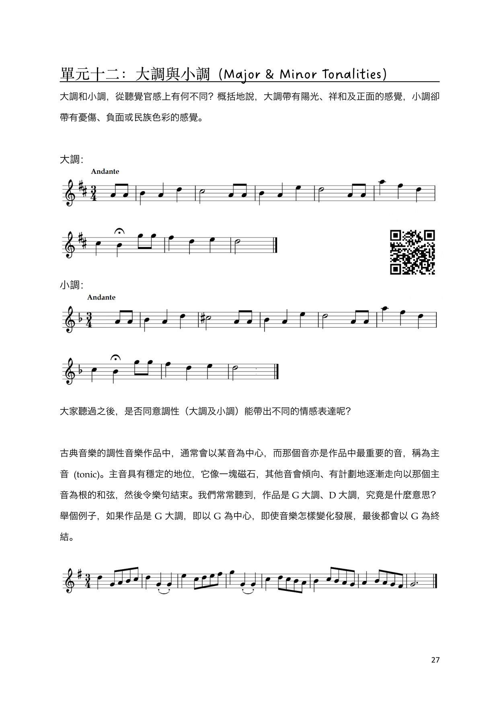

**音阶** (Scales),阶是阶梯,即以某种特定音程关系,上行或下行,以级进形式从某个音走向另一个八度的相同音名。在古典音乐里,音阶可分为大调、小调和半音阶三种:

- **大调音阶** (Major Scale):从主音开始,上行或下行走一个八度,第三四、第七八音是半音关系,其它是全音关系。如能符合这个条件的音阶,就是大调音阶。例如 G 大调音阶是 G A B C D E F# G,这也解释了为什么 G 大调会有一个升号 (F#)——为了符合以 G 音作为主音的大调音阶条件。
- **小调音阶**的第一个音,是从大调音阶的第六个音开始奏起。小调音阶可分为三类:
  - **自然小调音阶** (natural minor scale)
  - **旋律小调音阶** (melodic minor scale):上行时第六、七音升高半音,下行时第六、七音还原。
  - **和声小调音阶** (harmonic minor scale):无论上行或下行,第七音升高半音。

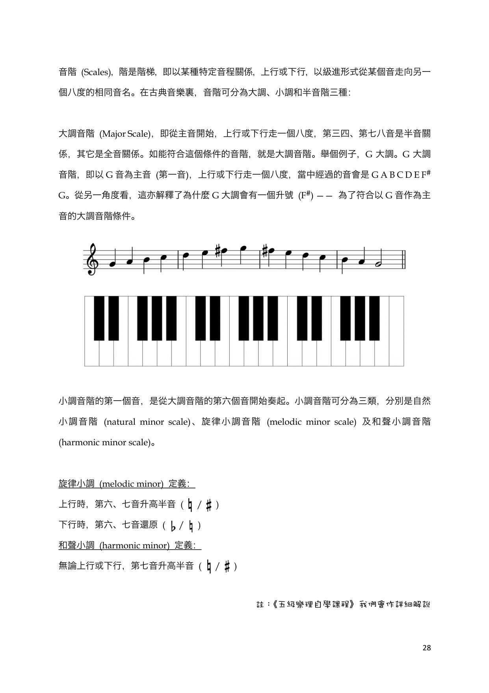

## 单元十三:调号 (Key Signatures)

在古典音乐中,一个八度可划分十二个音。如从某音开始,上行或下行,以级进走一个八度,便是以那音为主调的音阶。正因为一个八度可划分十二个音,所以就应有十二个不同主音的音阶,也形成十二个不同的调号。

十二个调的对应关系:

| 调号(升号) | 大调 | 小调(相对) |
| --- | --- | --- |
| 1 升 | G major | E minor |
| 2 升 | D major | B minor |
| 3 升 | A major | F# minor |
| 4 升 | E major | C# minor |
| 5 升 | B major | G# minor |
| 6 升 | F# major | D# minor |
| 调号(降号) | 大调 | 小调(相对) |
| 1 降 | F major | D minor |
| 2 降 | Bb major | G minor |
| 3 降 | Eb major | C minor |
| 4 降 | Ab major | F minor |
| 5 降 | Db major | Bb minor |
| 6 降 | Gb major | Eb minor |
| 无升降 | C major | A minor |

那么,十二个调之间有什么关系?它们有着相距五度的关系 (**circle of fifths,五度圈**)。为什么?

大调音阶是一种七声音阶,以第三四、第七八音为半音关系,其它为全音关系进行。C 大调音阶是 C D E F G A B C,没有任何升降号。G 大调音阶要符合条件,所经过的音是 G A B C D E F# G,因此 G 大调有一个升号 F#。D 大调有两个升号 (F#、C#),A 大调有三个升号 (F#、C#、G#),如此类推。

从以上得出的结果我们发现,在调号中,没有任何升降符号的是 C 大调,一个升号是 G 大调,两个升号是 D 大调,三个升号是 A 大调……它们之间有相距五度的关系。

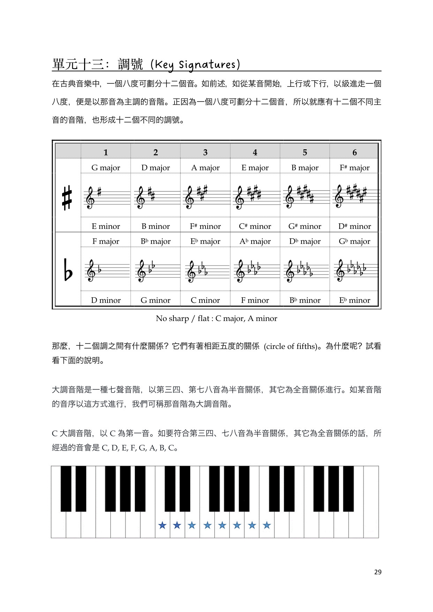

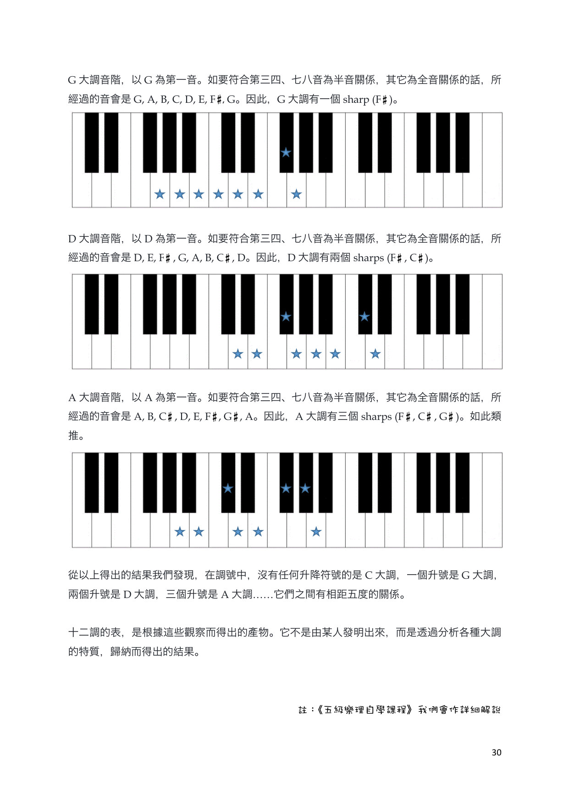

## 乐谱分析

以 Pachelbel《Canon a 3 Violini con Basso continuo》(帕赫贝尔《卡农》)为例,综合运用前面所学的乐理知识进行分析。

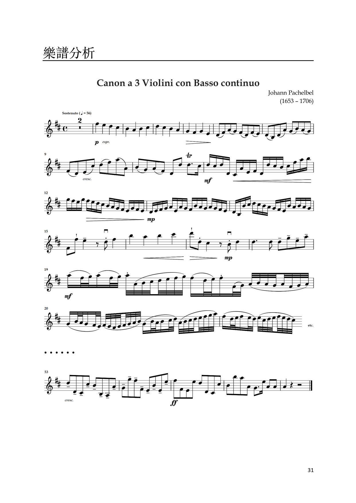

思考问题示例:

1. 作品是什么名字?
2. 作曲家是什么名字?
3. 作品是什么大调?
4. 作品的拍子记号是什么?是什么意思?
5. 作品的速度如何?是快板还是慢板?
6. 在选段中,哪一个小节的音量最强?
7. 在第十小节里,首四个音的音名分别是什么?
8. 在选段中,最短的拍子时值是什么?
9. 我们怎知道乐段在哪里完结?
10. 在第九小节及第十五小节中,从左至右逐拍圈起来,调较拍子机速度至 56,然后拍出这两小节的节奏。

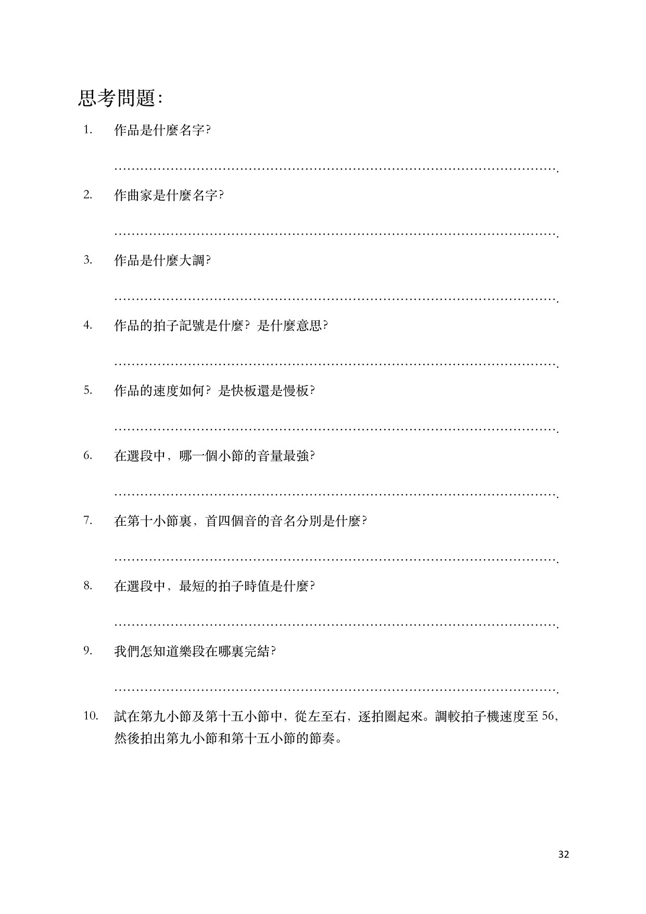

## 附录:怎样背默十二个调的表?

背默十二调表有一套系统的方法:

1. **先画一个长方形,划分 12 格**。在长方形之上,写上 123456,长方形之左边加上大调 (major)/ 小调 (minor)。

2. **每个调之间有相距五度的关系 (circle of fifths)**。从 C 开始数起,在大调那一行,从左至右写上英文字母 G, D, A, E, B, F。至于小调那一行,把大调一行的英文字母从右至左重抄一次。

3. **大调与小调有相距小三度 (minor 3rd) 的关系**。只要将大调的英文字母向前数三个英文字母,就是该大调的相对小调。所以填上小调:从右至左为 D, B, G, E, C, A / D, B, G, E(与"从右至左重抄一次"互相印证)。

4. **最后记住四个数字:1452**。即从右至左,分别加上一个升号(第一个调)、四个升号(第二个调)、五个降号…以升号行:1、4、5、2 分别对应 G、D、A、E、B、F#;降号行同样处理。第一部分的十二个调的表就完成了。

至于**调号**的背默,有两个要点:

- 在大调那一行,最右边升号的位置,是「该大调的前一个英文字母」(即倒数第二个音,如 G 大调的唯一升号落在 F);
- 在小调那一行,升号的位置是抄右边下一个大调的音名。

最终得到完整的十二调表(见单元十三表格),以及记忆口诀 **1452**。

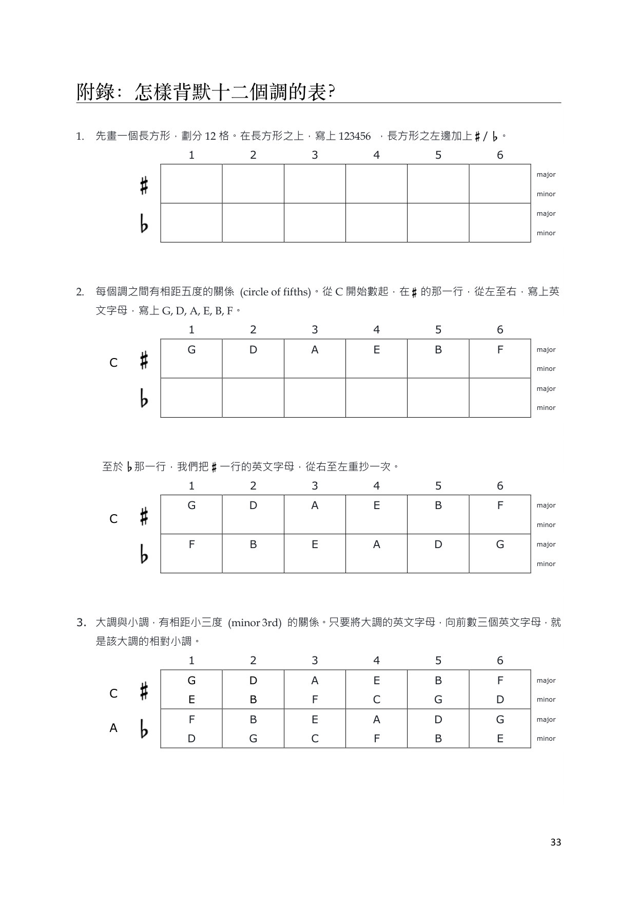

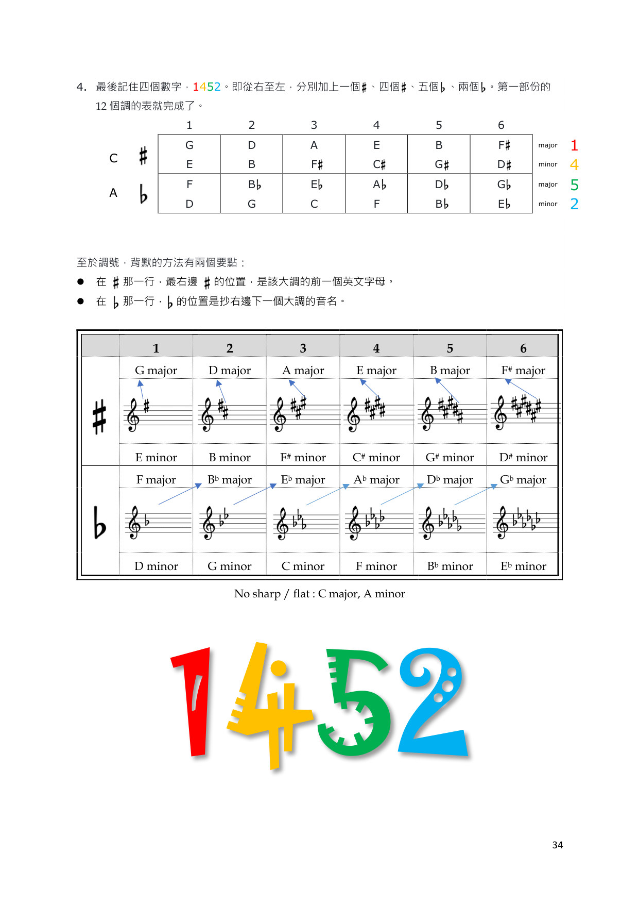
