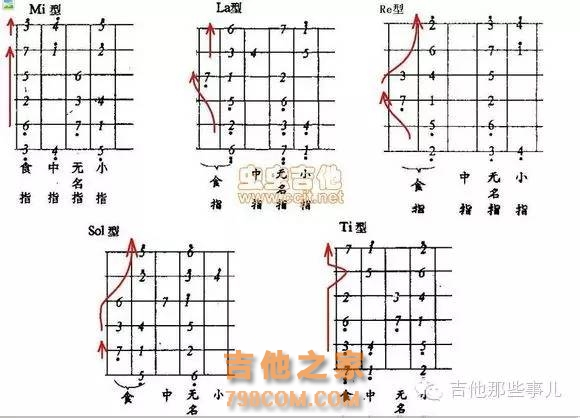
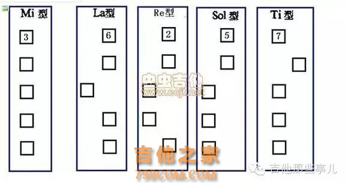
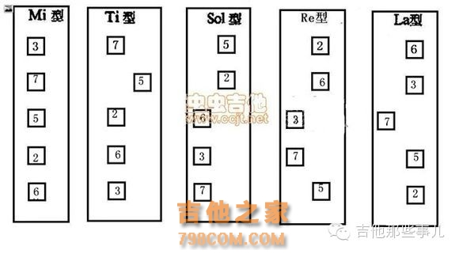
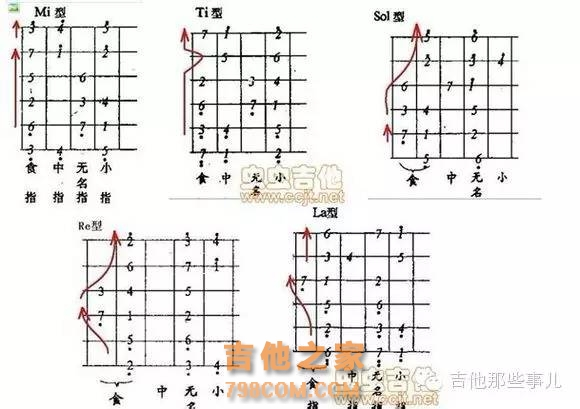
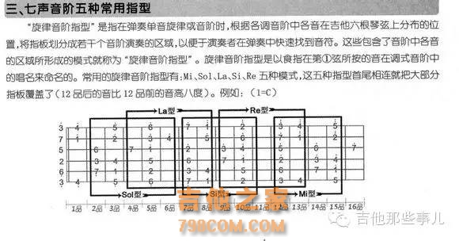
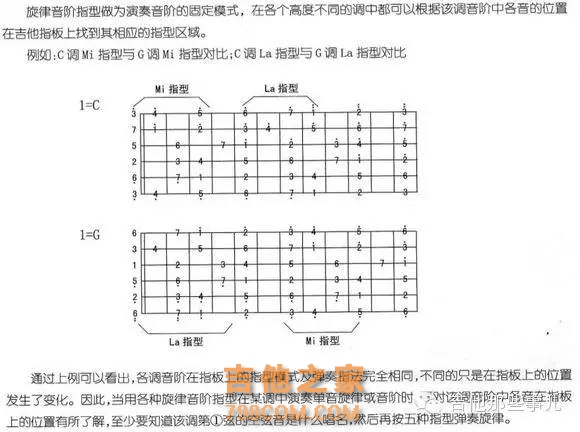

> 本文转载自「[吉他头条 · 吉他之家](http://www.798com.com/article-14252-1.html)」(发布于 2018-04-14),原文标题《solo音阶五种指型快速记忆》,仅供学习交流,版权归原作者所有。

**摘要**: 一共有几种指型?我们需要掌握 5 种,就是 Mi-La-Re-Sol-Ti,即 Mi 型、La 型、Re 型、Sol 型、Ti 型。是哪五个型也很好记,1234567 自然音阶中,少了半音关系中的后面一个音(我们知道 3 和 4、7 和 1 之间是半音关系),即 4(Fa)和 1(Do),没有 Fa 型和 Do 型。剩下 23567。

一共有几种指型?我们需要掌握 5 种,就是 Mi-La-Re-Sol-Ti,即 Mi 型、La 型、Re 型、Sol 型、Ti 型。

是哪五个型也很好记,1234567 自然音阶中,少了半音关系中的后面一个音(我们知道 3 和 4、7 和 1 之间是半音关系),即 4(Fa)和 1(Do),没有 Fa 型和 Do 型。剩下 23567。

我在标题为什么要排列成 36257,而不排列成 23567 呢?这是记忆的关键所在。首先 362573 是从六弦到一弦空弦的音。所以 362573 是大家应该非常熟悉的,不需要想就能脱口而出的。去掉最后一个 3 就是这个指型记忆法的口诀:**36257(Mi-La-Re-Sol-Ti)**。如果你还不能脱口而出 36257(Mi-La-Re-Sol-Ti),那么首先掌握它,因为这是运用的关键所在,我称它为口诀。

看看这个口诀如何运用到指型记忆中,先看下面的图,列出了 Mi-La-Re-Sol-Ti 五个指型图:

1. 首先我们注意到,不管哪个指型,六弦和一弦的音名是相同的,只是差两个八度。所以我们就不用去记第六弦的音了。只需要记一二三四五弦了。
2. 再看一下经过一二三四五弦的红色箭头,如果一个音型中有两个箭头,先看上面的,再看下面的,发现什么?箭头经过的音就是口诀 36257(Mi-La-Re-Sol-Ti)。
3. 但是,只有 Mi 型是一个直箭头,其它都有曲线。没错,除了口诀,我们还需要记住每个指型的"形状"。就是一二三四五弦,最前面一个音的位置所组成的"形状"。见下图:

按照 36257 的排列顺序(mi 在各个弦上面的顺序为起点)填空之后应该是下图:

这样我们就把指型记忆分解成了两个记忆内容,一个就是口诀 36257,另一个就是上面的"指型形状"图。这个图的变化也很有规律,从 36257,分别是"平""一凸""二凸""三凸""一凹"("一凹可以理解成四凸,以二弦为基准的话"),凸的位置是从三弦到五弦。不过这五个图的形状我已经牢牢记住了,就不需要凸呀凹呀地去记了。

**这样记忆有什么好处呢?**

**运用一**,比如确定了一个指型,比如 Re 型,我们很快可以反应出其它弦的音是什么,只要默念口诀 36257,就可以知道第三弦是 3、第二弦是 6、第一弦是 2(因为是 Re 型)、第五弦是 5、第四弦是 7。当然你还需要根据"指型形状"图,把这几个音放在正确的位置。

**运用二**,比如弹奏中弹到第三弦的音是 6,想用这个把位的指型时,口中默念口诀,可以马上反应要用 Sol 型。因为三二一弦,对应口诀中的 625,到一弦时是 Sol,所以用 Sol 型。

**指型记忆终极目标:**

以上方法不是记忆指型的最终目标,最终要达到什么效果呢?就是张三丰对张无忌说的,"忘记所有招式没有?忘记了也就学成了。"这个记忆方法也算是一种招式,真正完全掌握指型的,应该是不再需要什么口诀和方法,所有的指型都能一下子反应过来,不需要思考。但是这个需要长期地练习和强化,非专业人员可能很难达到这个水平,因为作为业余爱好者,没有那么多时间投入进去。但是相信这个 Mi-La-Re-Sol-Ti 方法,可以让你最轻松地向终极目标迈进。

正在练习,不过,我是按照它的反序 37526 来记忆的。因为可以看到一弦的食指,可以立刻反推出其他弦的各音。

只要能记住,别管用什么方法了,37526:米西(哈喽啊,饭已 OK 啦,下来米西吧)捎来啦。

几种指型口诀记忆为:米西捎来啦,西捎来了米,捎来啦米西,来啦米西捎,啦米西捎来。意思差不多,都和帮别人去食堂打饭有关系。多念两遍就记住了。

**图形记忆就像推格子游戏:**

米指型,游戏开始。

西指型,第二个往下推。

捎指型,再把第一个推下去。

来指型,再把推最下面的推下去。

啦指型,依次再推下去。只剩下一个 Si 音单独出列了。

