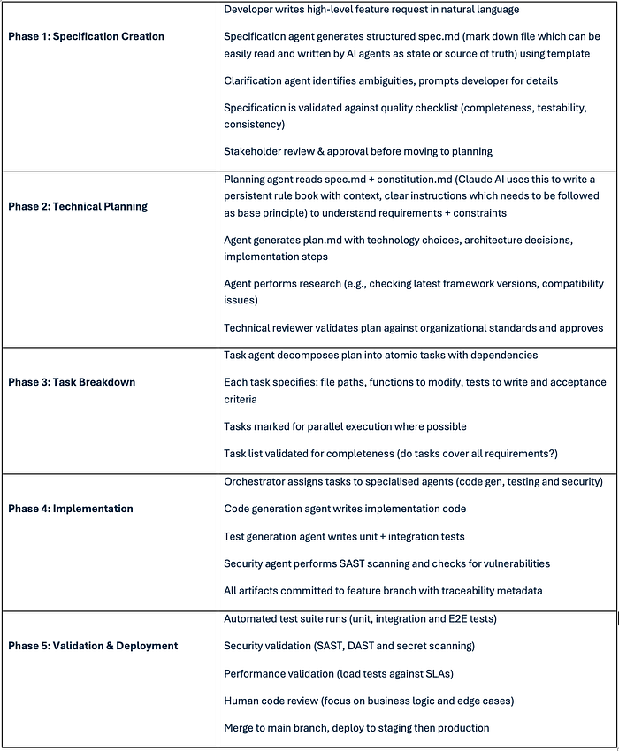
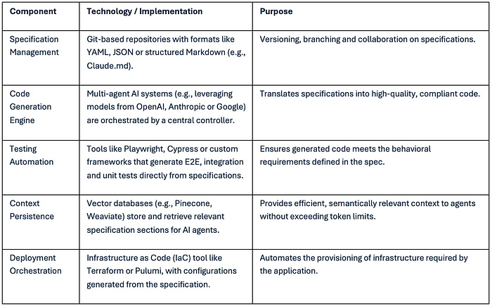
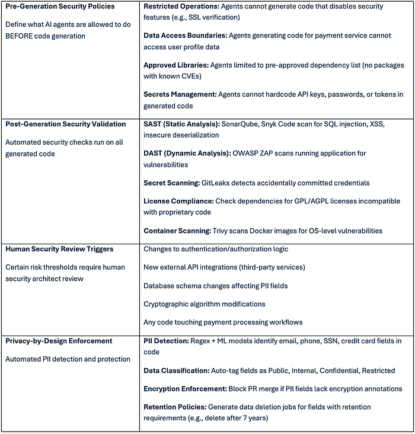
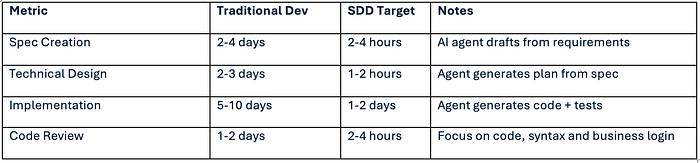

> 本文是 [《Specification-Driven Development (SDD) - AI First Coding Practice》](https://medium.com/ai-pace/specification-driven-development-sdd-ai-first-coding-practice-e8f4cc3c2fc4) 的中文翻译,原文作者为 Sudhakar Punniyakotti(发布于 2026 年 1 月 20 日)。

## 规范驱动开发（SDD）—— AI 优先编码实践

> **软件工程的新剧本**

*作者：Sudhakar Punniyakotti*
*阅读时长：13分钟*


**Lego Blocks © Claudio Caridi / Adobe Stock**

在过去15年里，我曾在软件工程的许多不同领域工作。我是 Sudhakar Punniyakotti，我的旅程始于 Ruby on Rails，随后扩展到广泛的编程语言、框架和架构模式。我构建过从经典单体架构到现代前后端技术栈、微服务、容器化应用、无服务器函数、Lambda 以及完整的云原生平台等各种系统。

大部分成长都是垂直方向的——在特定工具或技术栈层面上深化技能。但 AI 现在正在作为一种横向力量出现，无论我们构建什么、如何构建，它都触及软件开发的方方面面。

> 软件开发是一个不断寻找能够管理复杂性并加速交付的方法论的过程：

**瀑布模型：** 一种借用自制造业的顺序性、线性方法，被证明对于软件的动态特性过于僵化，因为需求经常在项目中途发生变化。

**敏捷及其变体（Scrum、看板）：** 引入了迭代开发、持续反馈和紧密协作，使团队能够适应变化。然而，敏捷是为以人为中心的工作流程设计的，具有灵活性。

**AI 辅助开发：** 强大的大型语言模型和编码代理的引入创造了一个新的拐点。这些工具能够以前所未有的速度生成代码，但缺乏人类开发者的内在上下文、架构意识和目标对齐能力，导致集成失败和不可维护的代码。

## 规范驱动开发的目的

AI 辅助的软件开发方法论无法管理由 AI 代码生成引入的规模、速度和复杂性。**SDD 是这一演进的下一个合理步骤**，专门设计用于优化人机协作接口。

AI 辅助编码方法存在以下问题：

1.  **上下文窗口限制：** 编码模型需要理解整个代码库才能跟踪新需求或下一个任务并将其转换为代码。由于有限的上下文窗口和上下文丢失，新变更的质量与代码库大小成比例下降。
2.  **歧义解决：** 自然语言需求在大多数情况下导致不一致的实现。
3.  **架构漂移：** 没有结构化规范，生成的代码缺乏内聚性。
4.  **测试缺口：** 临时的代码生成经常绕过系统化的测试工作流程，我们不知道自己构建了什么。
5.  **集成失败：** 独立生成的组件无法协同工作，导致后期出现意外。
6.  **团队开发：** 更注重个人的开发贡献，而非团队协作。

SDD 通过建立机器可读规范作为驱动整个软件开发生命周期（SDLC）的主要可执行工件来解决这一差距。

规范提供了 AI 代理在规模化运作时有效且可预测地执行所需的结构化上下文。它保留了敏捷的迭代本质，同时以新的自动化形式重新引入了瀑布模型的前期规划严谨性。

> 规范就是新的代码；它允许我们追溯、重复和协作。

**在这个模型中，规范不仅仅是文档；它们是治理设计、实现、测试和管控的权威事实来源。**

## 核心原则

**代码成为规范的实现或表达，由在结构化上下文中运行的 AI 代理生成和验证。**

> 代码服务于规范，而非反过来

这种方法将开发从一种氛围驱动或 AI 驱动的不可预测过程转变为一个可管理、可追溯、可重复和可扩展的工程学科。它确保随着我们越来越多地依赖 AI 来编写代码，人类意图保持控制地位，企业标准得到系统化执行：

1.  **意图先于实现：** 目标驱动，在"如何做"之前，必须全面定义"做什么"和"为什么"。规范捕获业务需求、用户故事和验收标准，独立于技术选择。
2.  **默认机器可读：** 规范使用结构化格式（YAML、JSON、带 Schema 的 Markdown），AI 代理可以无需人工解释即可解析、验证和执行。
3.  **上下文分层：** 信息按系统、功能和执行上下文组织，为 AI 代理提供适当粒度的信息。
4.  **多代理编排：** 复杂的开发任务被分解并分发给专门的 AI 代理（代码生成、测试、安全验证），由编排器协调。
5.  **每一层都进行验证：** 自动化质量关卡在工件进入管道之前验证规范完整性、代码正确性、测试覆盖率和安全合规性。
6.  **可追溯性：** 每一行代码、每一个测试用例和每一个部署操作都可以直接追溯到规范的特定部分。这提供了前所未有的可观测性和可审计性。
7.  **人在回路中的治理：** 关键决策点（架构选择、安全审查、业务逻辑验证）需要人类明确批准。
8.  **生命周期和版本管理：** SDD 生命周期遵循结构化流程：想法 → 规范 → 审查 → 代码生成 → 测试 → 重复。

### 与 TDD 和 BDD 的集成

SDD 建立在测试驱动开发（TDD）和行为驱动开发（BDD）的已验证原则之上。

**测试驱动开发（TDD）：** 建立**红-绿-重构**循环来跟踪每个功能，并标记为未测试、已测试、失败和成功，确保每段代码都有测试覆盖。这提高了代码质量和模块化设计。

**行为驱动开发（BDD）：** 通过关注用户行为来增强 TDD，使用共享的自然语言（如 Gherkin 的 **Given-When-Then** 格式）来对齐业务利益相关者、开发者和测试人员。

SDD 通过使规范成为代码和测试生成的来源来吸收这些实践。这创建了一个自动化循环，其中规范生成实现代码和相应的测试来验证该代码，确保意图和现实之间的完美对齐。

## 三层上下文架构

**标准的 AI 辅助编码或氛围编码存在关键缺陷：上下文衰减、集成失败和缺乏治理。** 在 SDD 中，我们通过有意的信息结构化来指导 AI 代理生成连贯、可维护的代码，从而尽量减少上下文、代码和人类之间的差距。

提出的三层模型在不同范围内提供这种上下文：

### 1. 系统上下文（组织级别）

定义适用于所有项目的基础约束和标准。

*   **技术栈：** 批准的语言、框架、云提供商和工具。
*   **架构模式：** 微服务、事件驱动和无服务器。
*   **安全策略：** 认证标准（OAuth 2.0）、授权和数据加密要求。
*   **编码标准：** Lint 规则、命名约定和代码格式化。
*   **合规要求：** GDPR、PII、HIPAA 和 SOC 2 义务。
*   **基础设施模板：** Terraform 模块、Kubernetes 配置和容器镜像。

### 2. 功能上下文（产品级别）

捕获特定功能的需求和验收标准。

*   **用户故事：** 作为[用户]，我想要[能力]，以便[收益]。
*   **验收标准：** 给定[前置条件]，当[操作]，则[结果]。
*   **API 契约：** RESTful 端点、GraphQL Schema 和事件消息格式。
*   **数据模型：** 实体 Schema、关系和验证规则。
*   **非功能需求：** 性能 SLA（响应时间 < 500ms）、可扩展性目标和业务需求。
*   **UI/UX 规范：** 线框图、设计系统组件和可访问性标准。

### 3. 执行上下文（任务级别）

提供代码生成和测试所需的运行时信息。

*   **当前代码库状态：** 相关文件、函数和依赖项。
*   **测试环境配置：** 数据库连接、环境文件、API 密钥（已遮蔽）和模拟服务。
*   **先前代理输出：** 其他代理生成的代码、测试结果和错误日志。
*   **任务特定指令：** 要修改的文件路径、要重构的函数和要编写的测试。

> **规范作为系统和功能上下文的持久容器，确保无论涉及多少个 AI 代理，它们都从单一的共享事实来源进行操作。**

## 开发生命周期和工作流程

SDD 遵循具有明确验证关卡的结构化工作流程，通用计划如下：



## 治理框架

在企业规模上实施 SDD 需要一个强大的治理框架来管理复杂性并确保一致性。

数据策略（我们拥有什么和我们需要什么的方法）大致遵循三层或五层方法，基于成熟度，类似于我们可以从以下三层开始治理：

### 架构层级

*   **基础层：** 核心基础设施，包括版本控制的规范仓库（例如使用 Git）、AI 代理工具链和标准化安全扫描器。
*   **工作流层：** 定义流程。包括规范模板、自动审查和批准工作流，以及将 SDD 集成到现有 CI/CD 管道中的模式。
*   **自治层：** AI 代理运行的地方。这一层受下层定义的严格护栏治理，允许在安全边界内进行自主代码生成和测试。

### 关键组件

*   **规范库：** 可复用规范组件的仓库（例如用于身份验证、日志记录和 UI 元素），加速开发并强制执行标准。
*   **合规自动化：** 嵌入规范流程的自动检查，确保所有开发都遵守监管（例如 GDPR）、安全和内部架构标准。
*   **可观测性和指标：** 跟踪开发流程健康状况的仪表板，包括规范到代码的保真度、测试覆盖率和从规范批准到部署的时间。

### 集成架构



### 安全和合规

AI 生成的代码引入了独特的安全风险。通过 SDD，我们可以在每一层嵌入安全验证。



## 规范演进和变更管理

规范是活的文档，管理其演进对于维护系统一致性至关重要。

*   **版本策略 ——** 规范使用标准语义版本控制：
    *   **主版本（2.0.0）：** 破坏性变更（API 签名变更、功能移除）
    *   **次版本（1.1.0）：** 添加新功能（新端点、新字段）
    *   **补丁版本（1.0.1）：** 错误修复、澄清（无功能变更）
*   **影响分析 ——** 在批准规范变更之前，使用代码代理分析下游影响

### 影响分析示例

**规范变更：** 向 Order API 添加必填字段"customerTier"

**影响分析：**

 - 受影响服务：3个（OrderService、BillingService、NotificationService）
 - 受影响端点：5个（POST /orders、GET /orders/:id 等）
 - 破坏性变更：是（缺少 customerTier 的现有客户端将验证失败）
 - 迁移策略：
   1. 在 v1 旁边部署 v2 API 端点（2周弃用期）
   2. 使用 customerTier 参数更新客户端 SDK
   3. 2周后弃用 v1 端点
 - 预估工作量：8个代理小时 + 4个人类小时（审查 + 测试）

**迁移路径 ——** 演进规范的结构化流程：

*   在单独分支中创建 spec.md v2.0
*   生成详细说明所需代码变更的迁移计划
*   以向后兼容模式部署 v2 端点（v1 和 v2 共存）
*   更新客户端以使用 v2 端点
*   监控 v1 使用量降至零
*   宽限期后弃用 v1 端点

### 错误恢复和回滚策略

1.  **弃用工作流 ——** 从测试失败中学习，改进未来的代码生成并修改 SDD

*   **失败：** orders.ts 第47行 NullPointerException
*   **根本原因：** 代理未能为可选的 customerTier 字段添加空值检查
*   **纠正措施：** 更新代码生成提示模板，为可选字段强制执行空值检查
*   **预防：** 添加静态分析规则，标记没有空值检查的可选字段访问

2.  **手动覆盖协议 ——** 有时工程师需要在规范驱动流程之外进行热修复

*   工程师直接提交热修复到主分支（绕过 SDD 工作流）
*   热修复标记为 OVERRIDE 标志 + 事件工单引用
*   事后：规范代理分析热修复代码变更
*   代理生成反映热修复逻辑的更新 spec.md
*   规范更新经审查 + 合并以保持规范与代码同步

3.  **重新规范工作流 ——** 生产事件通常揭示规范缺口

*   **事件：** 黑色星期五流量高峰期间的支付处理超时
*   **识别的缺口：** 规范缺少高流量场景的性能要求
*   **重新规范：** 添加 REQ-099："支持高峰流量期间每秒10,000个订单"
*   **实现：** 代理生成代码变更（数据库连接池、缓存层）
*   **验证：** 负载测试在部署前验证 10,000 req/s 的吞吐量

## 性能基准测试和成功指标

基准测试和指标帮助我们了解当前性能并衡量随时间的改进程度。以下是可能的干预措施，但具体的指标值因团队而异。

### 生产交付时间指标



*目标*

### 规范质量分数

跟踪规范完整性随时间的变化：

*   **完整性分数：** 已填写的必需部分百分比（目标：100%）
*   **歧义计数：** 被标记的模糊术语数量（目标：0）
*   **可测试性指数：** 可衡量的验收标准与总需求的比率（目标：>0.9）
*   **首次通过成功率：** 无需返工即通过验证的规范百分比（目标：>80%）
*   **澄清问题：** 每个规范平均需要的问题数（目标：<5）

### 代码质量指标

*   **测试覆盖率：** 自动化测试覆盖的代码百分比（目标：>80%）
*   **圈复杂度：** 每个函数的平均值（目标：<10）
*   **代码重复率：** 重复代码块的百分比（目标：<5%）
*   **技术债务比率：** 修复问题的工作量与开发工作量的比值（目标：<5%）
*   **安全漏洞：** 严重/高危 CVE 数量（目标：0）
*   **构建成功率：** 无需错误即可编译的生成代码百分比（目标：>95%）

### 开发者满意度指标

SDD 的成功不仅仅是速度——开发者必须感到更有生产力，而不是被流程开销所拖累。

*   **认知负荷：** 开发者是花时间在创造性问题解决上还是样板代码上？（通过调查测量）
*   **自主性：** 开发者能否无需官僚审批即可修改规范？（目标：>80% 自助服务）
*   **学习曲线：** 熟练掌握 SDD 的时间（目标：<2周）
*   **对 AI 输出的信任度：** 无需重大修改即使用的生成代码百分比（目标：>70%）
*   **流程摩擦：** 在 SDD 工具/流程上花费的时间与实际开发时间的比值（目标：<20%）

## 工具和实施

SDD 不是理论性的——多种 AI 辅助工具今天已经在实现这些模式。

### GitHub Spec Kit

Spec Kit 为 SDD 生命周期提供了结构化的斜杠命令：

*   `/speckit.constitution` - 定义项目原则（编码标准、技术栈、安全策略）
*   `/speckit.specify` - 从自然语言需求创建功能规范
*   `/speckit.clarify` - AI 代理就规范不足的部分提出澄清问题
*   `/speckit.plan` - 使用选定的技术栈生成技术实施计划
*   `/speckit.tasks` - 将计划分解为原子的、可操作的任务并标注依赖关系
*   `/speckit.implement` - 执行所有任务来构建功能
*   `/speckit.analyze` - 交叉检查规范、计划和任务之间的一致性
*   `/speckit.checklist` - 生成质量验证清单（"英语的单元测试"）

### 带 CLAUDE.md 文件的 Claude Code

Anthropic 的 Claude Code 代理使用 CLAUDE.md 文件提供持久的项目上下文。这些文件提供了跨会话持久的"项目记忆"。

**Claude.md 结构：**

1.  **项目级别：** 工作目录中的 CLAUDE.md 或 .claude/CLAUDE.md
2.  **用户级别：** ~/.claude/CLAUDE.md，用于所有项目的全局指令

```
# 项目指南

## 代码风格

## 测试

## 架构模式

## 安全要求

## 常用命令

## 文件结构
```

## 组织转型

采用 SDD 将催化软件开发团队的重大重组。

### 多阶段方法

**阶段1：单团队、绿地项目（x个月）**

选择1个团队（5-7名开发者）开发新功能。最少的遗留约束。衡量生产交付时间、代码质量和开发者满意度。

**阶段2：多团队、混合项目（x+x个月）**

识别与现有代码的集成和规范创建挑战。根据反馈和项目类型完善规范模板。

**阶段3：部门范围采用（x+x+x个月）**

绿地 + 棕地混合（x个月）——识别棕地和绿地项目，捕获挑战并致力于集成方面的工作。

### 成功指标

*   与传统开发相比，功能交付速度提升 x%
*   生成代码的测试覆盖率 >x%
*   x 个严重安全漏洞
*   开发者满意度 >x%（调查）
*   试点功能的工作生产部署
*   规范复用率 >x%（利用现有组件）
*   返工率 <x%（生成的代码首次满足需求）
*   记录了遗留系统的集成模式
*   通过 SDD 开发的新功能占比 x%
*   部门范围的生产交付时间减少 x%
*   建立了拥有 x+ 名认证 SDD 架构师的 CoE
*   开发者采用率 x%
*   证明了正向 ROI（成本节约 vs 工具投资）

### 新兴角色

传统开发者将转型为 AI 辅助实施者，他们的专长用于指导、完善和验证 AI 代理的输出，而不是手动编写每一行代码。

*   **规范架构师：** 专注于将业务需求转化为精确、全面和机器可读规范的高级角色。这成为组织中最关键的设计角色。
*   **上下文工程师：** 负责策划和管理信息环境（系统、功能和执行上下文）以指导 AI 代理的专家角色。
*   **AI 编排器 / 代理管理器：** 管理 AI 代理舰队，定义其角色、交互模式和工作流程以优化端到端开发过程。
*   **质量验证者：** 将重点从手动代码审查和测试转向验证规范质量和审计自动化系统的输出。
*   **SDD DevOps 工程师：** 为 SDD 工作流构建 CI/CD 管道。集成安全扫描、测试和部署自动化。

### 应对开发者抵触

规范驱动方法的新角色正在根据项目复杂性进行演变，但开发者的部分抵触可能源于以下信念：

> **"AI 将取代开发者"**

SDD 将开发者关注点从语法转向架构。你设计系统，AI 处理样板代码。对规范架构师、上下文工程师和 AI 代码审查者的需求正在增长。

> **"生成的代码质量较低"**

通过适当的规范 + 验证关卡，AI 生成的代码满足质量标准。自动化测试（>x% 覆盖率）+ 安全扫描能捕获传统开发遗漏的问题。

> **"流程开销太大"**

前期规范工作在减少调试、返工和集成问题方面得到了回报。尽管有规范步骤，生产交付时间仍然快了5-8倍。

> **"AI 不理解我们的领域"**

系统上下文（如 speckit — constitution.md）捕获领域知识。规范架构师将领域专业知识嵌入模板和验证规则中。

### 当前限制和约束

> **SDD 不是银弹，它有已知的限制和其他未知的未知因素**

*   **复杂业务逻辑：** AI 在需要深度上下文理解的复杂领域特定规则方面举步维艰（例如税务计算、保险承保）
*   **上下文窗口约束：** 大型规范（>100K tokens）需要分块策略。代理可能错过交叉引用依赖关系。
*   **新颖问题解决：** AI 擅长模式匹配，但在训练数据中未充分表示的架构性新颖解决方案方面举步维艰。
*   **前期投入：** SDD 需要3-6个月来建立模板、培训团队、构建管道，之后才能实现生产力提升。
*   **文化抵触：** 开发者的个人满足感会抵制向规范架构的转变。我们需要团队的有效变革管理来逐步向 SDD 迈进。
*   **规范债务：** 维护不良的规范变得过时，导致规范和代码之间的漂移。这需要持续的纪律和承诺。
*   **遗留系统集成：** 未记录遗留代码的棕地项目难以集成到 SDD 工作流中。

### 何时不使用 SDD

*   **快速原型/概念验证：** 前期规范开销会减慢探索性工作。对一次性原型使用"氛围编码"。
*   **单开发者个人项目：** SDD 开销只在团队规模上才有回报。个人开发者应直接使用 AI 助手。
*   **高度创意/艺术性工作：** 需要主观美学判断的 UI/UX 设计从结构化规范中获益较少。
*   **研究项目：** 当需求未知且以发现为驱动时，僵化的规范会限制探索。

## 总结

**SDD 超越了增量改进。它是一种核心技术和框架，能够实现下一代 AI 优先的架构模式。** 未来愿景可能包括一些有趣的概念：

*   **流动架构：** 通过更新规范来近实时更新自身的系统，变更自动通过代码、基础设施和部署传播。
*   **自主系统演进：** 监控生产系统并主动提出规范更新以提高性能、修复错误或基于用户行为分析添加功能的 AI 代理。
*   **跨平台融合：** 一个单一的通用规范，可用于同时为 Web、移动和后端平台生成原生实现，确保完美的功能对等性。

> 从提示到生产并不遥远，SDD 是带领我们到达那里的载体！

**规范驱动开发不是魔法，它是 AI 代理的通用语言和在企业环境中测试 AI 能力的基本框架。它将成为下一代软件开发的操作系统。**

---

*本文由 Sudhakar Punniyakotti — 技术架构师 — AI @ Pace Collective 成员提供*
*联系 [TCS Pace London 团队](https://www.tcs.com/what-we-do/pace-innovation/pace-port/london-pace-port-innovation-hub) 或 [Sudhakar on Linkedin](https://www.linkedin.com/in/psudhakars/)*
